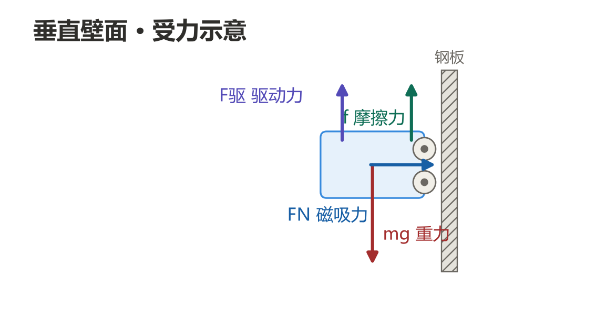
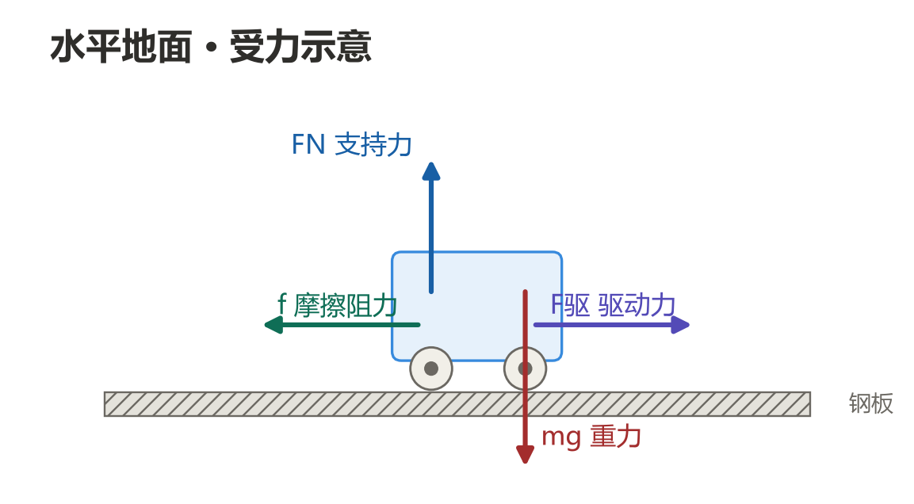
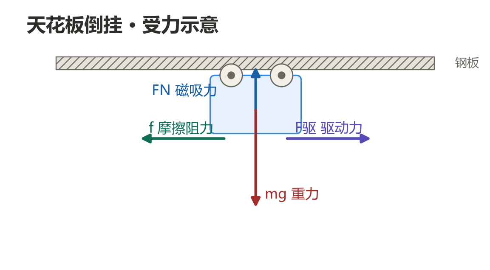
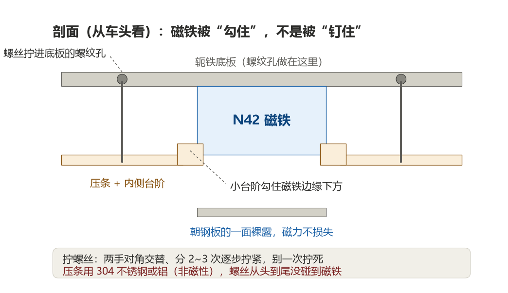
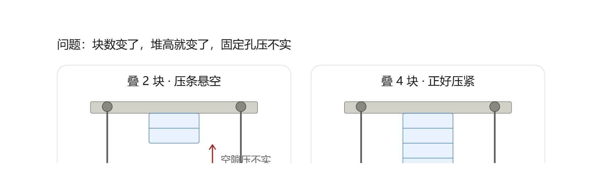

# 赛道 B 永磁爬壁机器人 · 第一周工作周报

**周次**：W1　**记录人**：wanlin050（组长）　**记录日期**：2026-11-26

---

## 一、本周工作概述

本周围绕赛道 B"永磁吸附爬壁机器人"项目的 W1 阶段目标开展工作。作为组长，本人除承担任务板维护、版本与预算台账、交付排期等统筹职责外，还独立完成了受力关系分析图绘制、候选技术方案论证撰写、团队 GitHub 项目框架搭建，以及 BOM 物资询价与价格比对四项具体工作。各项成果均按手册"可核验成果"要求留存证据，力求做到"做了什么、证据在哪、下一步做什么"清楚可查。

## 二、重点工作进展

### （一）受力关系分析图绘制

依据手册 7.3 节 W1 要求，完成重力、法向磁吸力、摩擦力与驱动力四种作用力的关系分析，针对垂直壁面、水平地面、天花板倒挂三种典型工况分别绘制受力简图。图中以红、蓝、绿、紫四色分别标注 mg 重力、FN 磁吸力（或支持力）、f 摩擦力、F驱 驱动力，直观呈现各工况下的力平衡关系。

**图 1　工况一：垂直壁面**

mg 向下、FN 水平指向钢板、f 沿墙向上抵消重力、F驱 沿爬升方向；判据 μ·FN ≥ mg，靠摩擦力抗滑。

**图 2　工况二：水平地面**

FN 为地面支持力与 mg 平衡，F驱 向前、f 为滚动阻力；对应阶段一无磁小车的差速与配重测试。

**图 3　工况三：天花板倒挂**

FN 竖直向上是唯一直接对抗 mg 的力，F驱 与 f 水平；无摩擦力帮忙承重，要求最高、最危险。

核心结论：垂直壁面依靠摩擦力抗滑，水平地面由支持力承重，天花板倒挂则完全依赖磁吸力硬扛重力。磁吸力并非越大越好——FN 增大虽提高吸附与抗滑，却同时增大滚动阻力、加重电机负荷，需在"吸得住"与"滚得动"之间取平衡。图件以 PNG 与 SVG 双格式存档。

### （二）候选技术方案论证与撰写

完成《候选方案》文档，确定总体构型为"两轮差速驱动 + 两轮辅助支撑 + 底盘下置插槽式永磁吸附模块"。供电方案为 3S 11.1V 锂电经 XT60 带开关转接线控制全车通断，TB6612 双路驱动板 VM 端接电池为左右电机供电，板载稳压 5V 经 VIN 端供 ESP32 主控。磁吸模块采用插槽式磁阵列结合长条孔压条：磁铁沿槽竖直叠放、槽壁导向防止横向错位；非磁性压条两端开长条孔，螺丝穿过长条孔拧入底板预埋铜螺母，压条可沿螺丝上下浮动贴合不同堆叠高度后锁死，配合气隙垫片实现磁力调节。

**图 4　压条勾边与螺丝锁止剖面**

磁铁被"勾住"而非被"钉住"，压条内侧小台阶勾住磁铁边缘下方，螺丝拧进底板的螺纹孔，磁铁本体不打孔、朝向钢板的一面完全裸露。压条须用 304 不锈钢或铝等非磁性材料，拧螺丝时两手对角交替、分 2~3 次逐步拧紧。

### （三）GitHub 项目框架构建

按手册 4.2 节要求创建团队仓库 Track-B-Magnetic-wall-Climber，建立 README + docs / firmware / hardware / reports / tests 目录骨架，并补充 requirements、system_architecture、bom、test_plan、week1 周报、LICENSES、cad、data 等文档，形成完整的开源协作载体与证据链。仓库骨架已通过结构核查，符合手册推荐规范。

### （四）BOM 物资采购、比价与清单

本周完成采购清单编制与电商比价，按结构件与控制件分为两表，价格均为采购参考价（未含运费）。

**表 1　结构件 BOM（合计 ¥106.47）**

| 零件名称 | 型号／规格                    | 数量  | 价格（元） |
| ---- | ------------------------ | --- | ----- |
| 结构件  | PETG 拓竹 3D 打印耗材 + 料盘     | 1 卷 | 51.19 |
| 磁铁   | N42 NdFeB 强磁 20×10×5(mm) | 8 颗 | 23.80 |
| 轭铁   | 镀锌铁板 — 定制规格（规格待定）        | 2 片 | 30.00 |
| 垫片   | 轻质塑料垫片                   | 1 包 | 1.48  |

**表 2　控制件 BOM（合计 ¥240.71）**

| 零件名称                      | 型号／规格                           | 数量  | 价格（元） |
| ------------------------- | ------------------------------- | --- | ----- |
| TB6612 驱动板                | 双路驱动模块（带稳压版）                    | 1 个 | 39.00 |
| 3S 锂电池 11.1V 2200mAh XT60 | 2200mAh 30C，106×34×24mm，XT60 母头 | 1 个 | 58.00 |
| B3 充电器                    | B3 10W（带线带充电盒）                  | 1 个 | 13.00 |
| XT60 带开关转接线               | XT60 转 30A 电流总开关线（非 XT60H）      | 1 个 | 19.88 |
| 面包板                       | 黑色基础款                           | 1 个 | 5.99  |
| 公对母杜邦线                    | 21cm 2.54mm                     | 1 排 | 2.04  |
| 公对公杜邦线                    | 21cm 2.54mm                     | 1 排 | 2.18  |
| 1kΩ 电阻                    | 1/4W 金属膜电阻 1%（100 个）            | 待填  | 2.24  |
| ESP32 单板                  | CP2102 芯片，Type-C 接口             | 1 个 | 19.80 |
| 电机                        | JGB37-520 霍尔编码器直流减速电机           | 2 个 | 72.42 |
| BB 响低压报警器                 | 1–8S                            | 1 个 | 6.16  |

**表 3　预算汇总**：结构件 4 项 ¥106.47，控制件 11 项 ¥240.71，合计 ¥347.18，低于 ¥2000 上限。

需说明两点：磁铁实际采购为 N42 NdFeB 20×10×5mm，与前期 20×20×10mm 设计不同，磁阵列排布与气隙设计须按实际尺寸调整；电机实际选用 JGB37-520 霍尔编码器减速电机，堵转电流、输出扭矩与减速比待实测，直接影响驱动板选型与配重测试。

## 三、交付物与证据索引

| 交付物               | 位置 / 形式                       | 状态    |
| ----------------- | ----------------------------- | ----- |
| 受力关系图（三工况）        | PNG + SVG，docs 目录             | 已完成   |
| 候选方案（图文版）         | Word 文档                       | 已完成   |
| 团队仓库框架            | Track-B-Magnetic-wall-Climber | 已搭建   |
| BOM v1 与比价表       | BOM.xlsx（结构 / 控制两表）           | 已完成   |
| 个人 README 与真实任务记录 | 各人仓库                          | 待各人确认 |

## 四、备选方案与最终方案对比

本周开篇提出的候选方案（两轮差速 + 两辅助轮 + 底盘下置插槽式永磁吸附模块）定位为备用方案，尚未经过实操验证。本周团队围绕磁路与电控两条线并行推进：磁路侧经有限元仿真与气隙—拉脱力理论推导确定磁装配体方案；电控侧从磁力实测出发，建立"静摩擦拟合 → 扭矩门槛 → 电机定案"的完整选型数据链。经对比论证，最终选定了有仿真与数据支撑的现行方案，备用方案则保留存档。

| 对比维度   | 候选方案（备用，未实操）       | 最终方案（已选定执行）                     |
| ------ | ------------------ | ------------------------------- |
| 来源定位   | 本周开篇提出的构型设想，作为备选存档 | 经磁路与电控两条线论证后确定，作为当前执行方案         |
| 磁力设计依据 | 依据经验估算磁力与气隙        | 经有限元仿真与气隙—拉脱力理论推导确定，附两版磁装配体结构迭代 |
| 电机选型依据 | 按常规工况粗选电机          | 按爬壁最坏工况校核，形成从磁力实测到电机定案的完整选型数据链  |
| 验证程度   | 未经实操，仅停留在方案层面      | 有仿真、理论推导与结构迭代支撑，关键参数已明确         |

**图 5　叠堆磁铁固定圆孔的问题（备用方案的未决问题）**

块数变化导致堆高变化，固定圆孔压条在某些块数下会悬空、压不实，气隙难以保持一致。该问题在备用方案阶段未经实操验证，凸显了最终方案以仿真与结构迭代确定磁装配体的必要性。

对比可见，备用方案因未经实操，在磁力依据、选型校核与结构细节上均停留在设想层面；最终方案则以磁路仿真、理论推导与实测数据链为支撑，方案确定性显著更高。保留备用方案并如实记录这一取舍过程，正对应手册"合理失败并被记录亦为有效成果"的要求，也可作为答辩时自主调研与方案比选的证据。

## 五、关口状态与小结

G0 安全基础准入待周末完成演练；G1 模块验证尚未开始，计划于 W2—W3 推进。本周已将 W1 的四项核心交付物落实到位，理顺了两阶段技术路线与采购节奏；采购清单按实际询价结果填写，控制件 11 项 ¥240.71、结构件 4 项 ¥106.47，合计约 ¥347.18。同时将开篇提出的候选方案定位为备用方案，与本周经磁路仿真和电控选型论证后确定的最终方案做了对比，如实记录了这一取舍过程。
